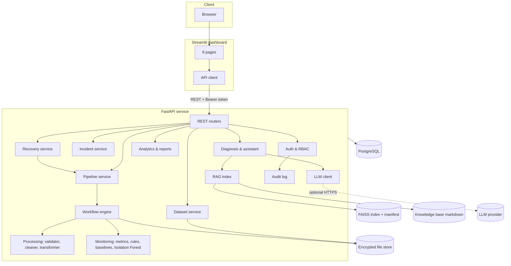
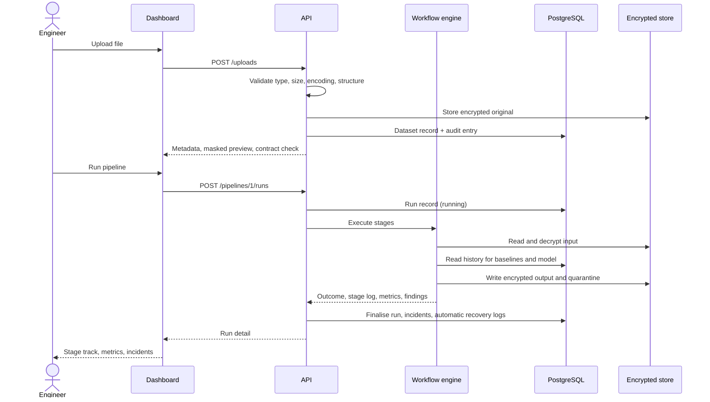
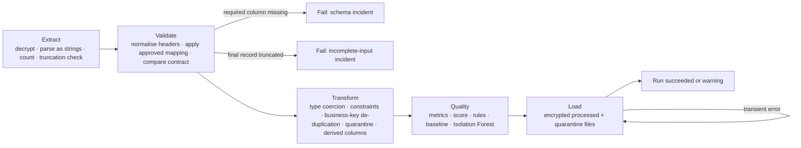
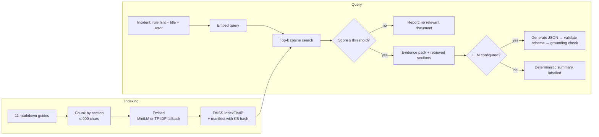
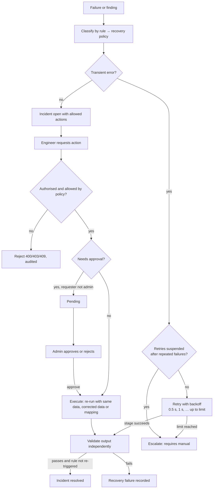
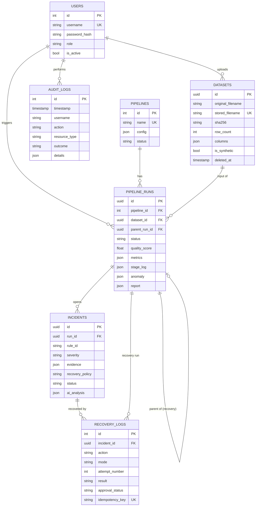
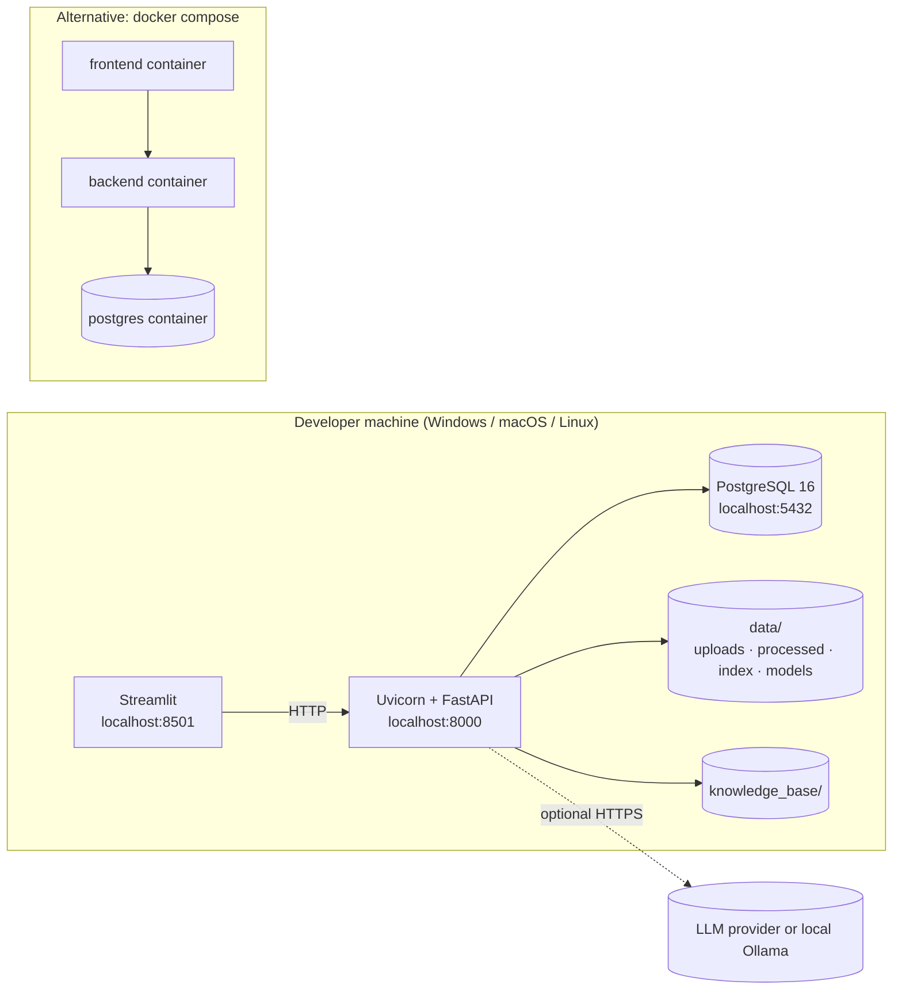

# DataPulse AI: An Intelligent Data Pipeline Monitoring, Root-Cause Analysis, and Automated Recovery Platform Using Machine Learning, Generative AI, and Retrieval-Augmented Generation

Final-year B.Tech project report · Department of Computer Science and Engineering

---

## 1. Abstract

Organisations depend on ETL pipelines to move data from operational systems into reporting and analytics. These pipelines fail in ways that are slow to diagnose: a renamed column, a partial file transfer, a replayed extract or a transient database outage can each corrupt reports or stop processing, and engineers typically investigate by reading logs by hand. DataPulse AI is a platform that processes CSV and JSON datasets through a five-stage ETL workflow, measures data quality, detects anomalies with deterministic rules and an Isolation Forest, explains incidents with an evidence-grounded assistant combining a large language model with retrieval over a troubleshooting knowledge base, and recovers from eligible failures through predefined, authorised and audited actions. It is built with FastAPI, PostgreSQL, Pandas, scikit-learn, FAISS and Streamlit and runs entirely on local infrastructure. On 100 labeled synthetic datasets the rule engine detected 96% of injected issues with no false alarms on clean data; combining rules with the Isolation Forest reached an F1-score of 0.99. Retrieval placed the correct troubleshooting document in the top three results for 91.7% of labeled questions, every eligible transient failure was recovered and validated automatically, and every failure beyond the retry limit was escalated rather than retried.

## 2. Introduction

Data engineering has become central to how organisations make decisions. Sales, finance and operations teams consume dashboards that are only as reliable as the pipelines feeding them. A pipeline extracts records from a source, transforms them into a consistent shape and loads them into a store used for analysis. Each step can fail, and some failures are silent: a pipeline that loads half of yesterday's transactions "succeeds" while the revenue report is wrong.

Monitoring tools commonly report whether a job succeeded and how long it took. They rarely explain why a run produced suspicious data or what to do next, and automated retries are often applied indiscriminately, re-running jobs that will fail identically. Recent advances in machine learning and generative AI offer a way to narrow this gap, provided they are used carefully: models can flag unusual behaviour and summarise evidence, but they must not invent facts or take unsafe actions.

DataPulse AI explores that combination. It treats deterministic validation as the source of truth, uses machine learning as an additional signal, uses generative AI to explain rather than to decide, and limits automation to a small catalogue of safe recovery actions.

## 3. Problem statement

Given a stream of dataset deliveries to a data pipeline, build a system that (a) processes each delivery through a validated ETL workflow, (b) detects data-quality problems, schema changes, abnormal volumes, processing failures and repeated failures, (c) explains each detected incident with evidence and a probable cause, (d) executes only safe, predefined recovery actions with appropriate authorisation, and (e) records every run, incident and action for audit, while remaining usable when no language model is available.

## 4. Existing system

In a typical small or mid-sized data team the existing approach consists of scheduled scripts or ETL jobs, application logs, and an alerting rule that fires when a job exits with an error. Data-quality checks, where they exist, are ad hoc assertions inside the transformation code. When something goes wrong an engineer reads the logs, compares the input with previous days by hand, looks up internal notes or asks colleagues, fixes the cause and reruns the job, often by restarting it manually.

## 5. Limitations of the existing system

The existing approach has several weaknesses. Jobs that complete but load bad data raise no alert. Volume drops and distribution changes go unnoticed without historical comparison. Diagnosis depends on individual experience and on reading raw logs. Troubleshooting knowledge is scattered and not retrieved at the moment it is needed. Retries are either absent or blind, so deterministic failures are retried pointlessly and transient failures wait for a human. Cleaning steps frequently delete bad rows without keeping evidence, which makes decisions irreversible and unauditable. Finally, there is usually no record of who reran what and why.

## 6. Proposed system

DataPulse AI adds an intelligent monitoring and recovery layer around the pipeline:

- Every delivery is validated, processed through explicit stages and stored with its full execution history.
- Rejected records are quarantined with reasons instead of deleted.
- Rules with configurable thresholds and historical baselines detect known problem types; an Isolation Forest flags unusual combinations of run metrics.
- Each detected problem becomes an incident with measured evidence, a probable cause and a recommended action from a recovery policy.
- An assistant retrieves relevant troubleshooting documentation and, when an LLM is configured, writes an explanation that is schema-validated and checked for invented numbers.
- Transient errors are retried automatically with exponential backoff; other actions are limited to a catalogue, require the right role, may require approval, and are followed by independent validation of the output.
- A dashboard presents runs, quality, incidents, analyses, recovery history and reports.

## 7. Objectives

1. Build a complete ETL pipeline supporting CSV and JSON ingestion.
2. Validate and clean datasets while preserving evidence for every rejected record.
3. Detect data-quality problems with transparent, configurable rules.
4. Detect anomalies with machine learning using the pipeline's own history.
5. Track pipeline execution history, incidents and recovery actions in PostgreSQL.
6. Explain failures with an LLM grounded in stored evidence, with a non-LLM fallback.
7. Retrieve troubleshooting guidance using RAG over a FAISS index.
8. Execute controlled recovery procedures with authorisation, approval and output validation.
9. Provide a professional interactive dashboard.
10. Apply security practices: authentication, role-based access, encryption at rest, audit logging and secret management.
11. Evaluate the system quantitatively with reproducible experiments.
12. Prepare the application for container-based and hosted deployment, and map it to the four Wipro CPPE modules.

## 8. Scope

In scope: tabular CSV and JSON files up to a configurable size (20 MB by default); a declarative column contract per pipeline (types, required fields, minimums, allowed values, business key); single-node processing with Pandas; one default sales pipeline plus user-registered pipelines; local deployment with optional hosting.

Out of scope: streaming sources, distributed processing, direct database or API connectors (the design allows them as additional ingestion adapters), automatic modification of pipeline code, and execution of any command proposed by the language model.

## 9. Functional requirements

| ID | Requirement |
|---|---|
| FR1 | Users can sign in; access depends on role (viewer, engineer, admin). |
| FR2 | Engineers can upload CSV/JSON files, which are validated for type, size, encoding, structure and emptiness. |
| FR3 | Users can preview a dataset and see a contract check, with sensitive columns masked. |
| FR4 | Engineers can run a pipeline on a dataset; the run passes through Extract, Validate, Transform, Quality and Load. |
| FR5 | The system quarantines invalid, incomplete and duplicate records with reasons and produces a processed output and a quality report. |
| FR6 | The system computes quality metrics and a quality score per run. |
| FR7 | The system evaluates rules for duplicates, missing values, invalid values, schema drift, volume changes, slow runs, truncated input and repeated failures. |
| FR8 | The system scores each run with an Isolation Forest when enough history exists. |
| FR9 | The system creates incidents with severity, evidence, probable cause, recommended action and policy. |
| FR10 | Engineers can request an analysis; the system retrieves documentation and produces an explanation (LLM or labelled fallback). |
| FR11 | Users can ask follow-up questions about an incident. |
| FR12 | The system retries transient failures automatically within a limit and records each attempt. |
| FR13 | Engineers can request predefined recovery actions; actions that change data interpretation require admin approval. |
| FR14 | Recovery outcomes are validated before an incident is marked resolved. |
| FR15 | Users can export runs, quality, incidents and recovery history as CSV or JSON; admins can export the audit log. |
| FR16 | Admins can manage users, view the audit log, rebuild the knowledge-base index and apply data retention. |

## 10. Non-functional requirements

| Category | Requirement and how it is met |
|---|---|
| Reliability | Retries only for transient errors; repeated-failure suspension; independent output validation; idempotent recovery requests. |
| Security | PBKDF2 password hashing, signed expiring tokens, role checks on every endpoint, encryption at rest, audit trail, masked previews, sign-in throttling, no secrets in code. |
| Availability without AI | All processing, detection, incident creation and recovery work without an LLM key. |
| Performance | 100,000 records processed end-to-end in about 1.5 s on a single shared CPU (Section 21). |
| Maintainability | Modular packages, typed schemas, Alembic migrations, 61 automated tests, CI on SQLite and PostgreSQL. |
| Usability | Plain-language messages, empty states that say what to do next, consistent visual language, keyboard-visible focus. |
| Portability | Runs on Windows, macOS and Linux; Docker images for both services. |
| Transparency | Every dashboard figure is derived from stored records; rule thresholds are configurable and documented. |

## 11. Architecture

The dashboard is a thin client: it holds the access token in session memory and calls the backend for every number it displays. The backend is a single deployable service organised into layers (API, services, domain modules, persistence), which keeps the first version simple to run while preserving clear boundaries that could later be separated into services. PostgreSQL stores all metadata; record-level files are stored encrypted on disk and addressed only by server-generated names.

## 12. Data flow

## 13. ETL workflow

All values are parsed as strings at extraction so that every conversion failure is recorded as evidence in the transform stage rather than lost in a library default. Derived columns use a whitelist of expressions; there is no evaluation of user-supplied code.

## 14. RAG workflow

The index is persisted with a manifest containing a hash of the knowledge base. On start-up the service loads it if the hash matches and rebuilds it otherwise, which also covers hosts whose local disk does not survive restarts.

## 15. Recovery workflow

The language model is never on this path. It may recommend an action in prose, but execution is possible only through the recovery service, which checks the policy catalogue, the caller's role, approval status, retry counts and idempotency keys.

## 16. Database schema

Check constraints enforce valid roles, statuses, severities, results, approval states, quality-score range and positive attempt numbers. Composite indexes support the most frequent queries (runs by pipeline and time, incidents by status and severity). The schema is created and versioned with Alembic, and CI verifies that the migrations match the ORM models.

## 17. Algorithms

**Schema comparison and rename suggestion.** Headers are normalised (lower case, non-alphanumerics to underscores). Missing and unexpected columns are computed by set difference. For each missing column, every unexpected column is scored with a sequence-similarity ratio, raised to 0.85 when tokens match as abbreviations (`cust_id` ↔ `customer_id`). Suggestions at or above 0.6 are reported; they are never applied automatically.

**Truncation detection.** The final row is flagged when at least half of its fields are empty while the remaining rows are less than a quarter as sparse, the signature of an interrupted transfer.

**Quality score.** Score = 100 × (0.30·completeness + 0.25·uniqueness + 0.35·validity + 0.10·schema conformance), where completeness is the share of rows with all required values, uniqueness the share of rows not duplicating an earlier business key, validity the share without type or constraint violations, and schema conformance 1.0 for an exact contract match or 0.5 otherwise.

**Baselines.** For each pipeline, the median record count and median duration of the last 30 completed runs form the baseline, only when at least five runs exist. Volume deviation = (records − median) / median; a drop of 50% or more and a rise of 100% or more are flagged. A run slower than three times the median duration (and over two seconds) is flagged.

**Isolation Forest.** Features per run: log₁₀ input records, percentage of rows with missing required values, duplicate percentage, invalid percentage, processing duration and volume deviation. Features are standardised (zero-variance columns guarded), and a 200-tree forest with contamination 0.02 is trained on the pipeline's completed runs once at least ten exist. A negative decision score marks the run unusual; the three features with the largest standardised deviation are reported as context. The contamination value was chosen by the ablation in Section 21. If any rule already fired, the forest's verdict is attached to those incidents instead of creating another one.

**Retry with exponential backoff.** Delay before retry *n* = base × factor^(n−1) (0.5 s, 1 s by default), up to two retries. Only `TransientError`, database `OperationalError`, timeouts and connection errors are retryable. If at least three of the last five runs failed, automatic retries are suspended until the repeated-failure incident is reviewed.

**Grounding check.** All standalone numbers in the model's summary, evidence, cause and action are extracted (digits inside identifiers are ignored) and compared with the numbers present in the evidence pack and retrieved documents; any number not found is reported to the user as unverified.

## 18. Implementation details

The backend is Python 3.12 with FastAPI and Pydantic for the API, SQLAlchemy 2 and Alembic for persistence, Pandas and NumPy for processing, scikit-learn for the Isolation Forest and TF-IDF fallback, Sentence Transformers for embeddings, FAISS for vector search, httpx for the LLM client, PyJWT for tokens and `cryptography` (Fernet) for encryption at rest. The dashboard uses Streamlit with Plotly and a custom stylesheet.

Notable design decisions:

- **Evidence over assertion.** Incidents store the measured values that triggered them. The assistant's "confirmed facts" are generated from those stored values by code, not by the model, and are displayed separately from model output.
- **Quarantine, never delete.** The original upload is preserved; each rejected row keeps its source row number and reasons.
- **Failure simulation.** A fault injector, available only to engineers and administrators and disabled by a configuration flag, raises labelled simulated transient errors in a chosen stage so recovery paths can be demonstrated and tested deterministically.
- **Synthetic data.** All demonstration data is generated from fixed seeds and labelled synthetic throughout the interface and reports.
- **Interface.** A white canvas, slate text and a single deep-teal accent, with one signature element: a stage track that shows each run's five stages, their outcomes and retries at a glance. Key figures are presented as a single ledger strip rather than separate cards.

## 19. Security and governance

| Control | Implementation |
|---|---|
| Authentication | Username and password; PBKDF2-HMAC-SHA256 with 600,000 iterations and per-user salt; HS256 tokens that expire (8 hours by default). Sign-in is throttled after five failures in five minutes. |
| Authorisation | Permission map evaluated on every endpoint: viewer (read), engineer (upload, run, analyse, update, request recovery), admin (approve, delete, audit, user and pipeline management, index rebuild). |
| Data protection | Uploads and outputs encrypted at rest; sensitive columns masked in previews and quarantine samples for anyone other than an administrator or the engineer who ran the pipeline; record downloads restricted the same way. |
| Secret management | All secrets come from environment variables; production mode refuses to start without `SECRET_KEY`, `DATA_ENCRYPTION_KEY` and `DATABASE_URL`; the LLM key is used only by the backend. |
| Input safety | File type, size, encoding and binary checks; filenames sanitised; data parsed, never executed; whitelisted transformation expressions. |
| Safe errors | Global handlers return generic messages; paths, stack traces and database details are never exposed; database outages return 503. |
| Audit | Sign-ins (including failures), uploads, runs, analyses, recovery requests, approvals, downloads, exports, deletions and configuration actions are recorded with user, resource, outcome and source address. |
| Governance | Recovery policies are explicit and documented; data-changing actions require approval; data retention deletes old files while keeping metadata; synthetic data is labelled. |
| Transport and headers | HTTPS is expected at the hosting layer; HSTS in production; `nosniff`, `DENY` framing, no-referrer and no-store headers; configurable CORS. |

Items that are not production-ready are listed in [SECURITY.md](SECURITY.md).

## 20. Testing methodology

Testing is automated with pytest and runs on every push through GitHub Actions against both SQLite and PostgreSQL 16. The 61 tests exercise the system through its public API using FastAPI's test client, with an isolated database and data directory per session and a seeded baseline of twelve synthetic runs.

All twenty required scenarios are covered: valid CSV and JSON uploads; unsupported file types; empty datasets; missing required columns; duplicates; missing values; invalid numeric values; schema changes; abnormal record-count reduction; clean data not flagged as anomalous; transient failure recovery; retry limits; LLM unavailability; relevant and irrelevant RAG retrieval; unauthorised recovery; database persistence errors; upload size limits; and invalid recovery requests.

Additional tests cover encryption at rest, filename sanitisation, insufficient history handling, truncated input, CSV/JSON equivalence, the backoff schedule, non-retryable errors, admin approval, idempotency, repeated-failure suspension, LLM responses (valid, invented numbers, invalid JSON, rate limiting, timeouts, server errors and the Anthropic format, all with mocked HTTP), index rebuilding, each assistant question type, sign-in throttling, admin-only endpoints, the audit trail, masking, safe 503 responses, reports, security headers and password hashing.

The dashboard is tested too: each of the nine pages is executed through Streamlit's `AppTest` harness with the API client routed to the in-process backend, and the test asserts that no exception or error element is produced. A further test drives the user flow of importing a sample and running the pipeline through the interface, and another checks that the sign-in screen rejects a wrong password.

Quantitative evaluation (`scripts/evaluate.py`) is separate from unit testing and is described next.

## 21. Experimental results

All experiments use synthetic data generated from fixed seeds in an isolated temporary database; the full output, including per-case details, is in [evaluation_results.md](evaluation_results.md). Results were measured on a single shared CPU in a Linux container with SQLite.

**Data-quality detection.** 100 labeled datasets: 25 clean, 25 with missing values, 20 with duplicates, 15 with schema changes and 15 with reduced volume. Injection strength was randomised, including cases below the thresholds.

| Injected issue | Detection rate |
|---|---:|
| Missing values | 100% (25/25) |
| Duplicates | 100% (20/20) |
| Schema change | 100% (15/15) |
| Volume reduction | 80% (12/15) |
| Overall | 96% |
| False alarms on clean data | 0% (0/25) |

The three missed volume cases retained 52–56% of the normal volume, which is a drop smaller than the 50% threshold; they are correct behaviour for the configured rule rather than defects.

During evaluation an earlier version of the missing-value rule measured missing *cells* and detected only 48% of missing-value cases, because 15% of rows being unusable translated into a cell rate under the threshold. The rule was changed to measure the share of rows missing a required value, matching the completeness dimension of the quality score.

**Anomaly detection.** The Isolation Forest was trained on 40 clean runs and tested on the 85 labeled runs that produced features (schema failures stop before features exist).

| Detector | Precision | Recall | F1 | False-positive rate |
|---|---:|---:|---:|---:|
| Isolation Forest alone | 0.94 | 0.27 | 0.42 | 0.04 |
| Rules alone | 1.00 | 0.95 | 0.97 | 0.00 |
| Rules or Isolation Forest | 0.98 | 1.00 | 0.99 | 0.04 |

Ablation over the contamination parameter (same data):

| Contamination | F1 | False-positive rate |
|---|---:|---:|
| auto | 0.75 | 0.44 |
| 0.02 (chosen) | 0.42 | 0.04 |
| 0.05 | 0.41 | 0.12 |
| 0.10 | 0.65 | 0.24 |

The forest alone has low recall: missing values and duplicates are already handled precisely by rules, and the model mostly catches volume anomalies. Its value is as a safety net that, combined with the rules, recovered the three volume cases the rules missed. Because it opens incidents when rules are silent, false alarms are the costlier error, so the contamination with the lowest false-positive rate was chosen over the one with the best stand-alone F1. Isolation Forest figures vary slightly between evaluation runs because processing duration, one of the features, is measured wall-clock time.

**Retrieval.** 24 labeled questions over 51 chunks with the TF-IDF backend (the evaluation environment could not download the Sentence Transformers model): hit@1 87.5%, hit@3 91.7%, mean reciprocal rank 0.90, and 5/5 off-topic questions correctly returned no document.

**Throughput.** End-to-end, including decryption, validation, cleaning, scoring, encrypted writes and persistence:

| Records | Median duration | Records per second |
|---:|---:|---:|
| 1,000 | 0.18 s | 5,720 |
| 10,000 | 0.41 s | 24,539 |
| 50,000 | 0.89 s | 56,186 |
| 100,000 | 1.56 s | 64,277 |

**Recovery.** With a retry limit of two, 10/10 runs with one or two simulated transient failures recovered automatically and passed output validation; 5/5 runs with three failures were stopped and escalated; 5/5 schema incidents were resolved by an approved column mapping.

**Explanations.** For one incident of each of the eight rule types produced during evaluation, the rule-based summaries named the correct incident category 8/8 times, contained no unverified numbers 8/8 times, and the expected troubleshooting document appeared in the top three retrieved sections for 5/5 types that have a dedicated guide. LLM-written explanations were not evaluated quantitatively because no API key was available in the evaluation environment; the same script evaluates them when a key is configured.

## 22. Limitations

- Processing is single-node Pandas; it is not distributed big-data processing.
- All evaluation data is synthetic, generated by the same author who wrote the rules, so real-world performance will differ.
- The Isolation Forest is trained per pipeline on a short history; its usefulness depends on that history being representative.
- LLM explanation quality was not measured with a live model.
- Runs execute synchronously in the request, which suits the upload limit but not very large files.
- Authentication is local username/password without single sign-on, multi-factor authentication or token revocation.
- The column contract is declared in JSON; there is no visual contract editor.

## 23. Future enhancements

- PySpark processing for large datasets, keeping the same contract and rules.
- A task queue (for example Celery or RQ) for asynchronous runs, scheduled pipelines and progress updates.
- Ingestion adapters for databases, object storage and REST APIs.
- Drift detection on value distributions (population stability index, Kolmogorov–Smirnov) in addition to run-level metrics.
- A read-only diagnostic agent that can call approved query tools (previous runs, column profiles) during an investigation.
- Evaluation of LLM explanations with human raters and with several models.
- Single sign-on, multi-factor authentication and key rotation through a secrets manager.
- Notifications to e-mail or chat when critical incidents open.

## 24. Conclusion

DataPulse AI shows that intelligent pipeline monitoring does not require handing control to a model. Deterministic validation provides precise, explainable detection; machine learning adds a measured safety net; retrieval brings the relevant troubleshooting knowledge to the incident; a language model, when available, turns evidence into readable explanations under schema and grounding checks; and recovery remains a small, authorised, audited and verified set of actions. The evaluation quantified each part, exposed and corrected a weakness in the original missing-value rule, and justified the anomaly-detection threshold with an ablation rather than intuition. The system runs locally, is covered by automated tests across two databases and the user interface, and is prepared for container and hosted deployment.

## 25. References

1. F. T. Liu, K. M. Ting and Z.-H. Zhou, "Isolation Forest," *Proc. IEEE International Conference on Data Mining (ICDM)*, 2008, pp. 413–422.
2. P. Lewis et al., "Retrieval-Augmented Generation for Knowledge-Intensive NLP Tasks," *Advances in Neural Information Processing Systems (NeurIPS)*, 2020.
3. N. Reimers and I. Gurevych, "Sentence-BERT: Sentence Embeddings using Siamese BERT-Networks," *Proc. EMNLP-IJCNLP*, 2019.
4. J. Johnson, M. Douze and H. Jégou, "Billion-scale similarity search with GPUs," *IEEE Transactions on Big Data*, vol. 7, no. 3, 2021 (FAISS).
5. F. Pedregosa et al., "Scikit-learn: Machine Learning in Python," *Journal of Machine Learning Research*, vol. 12, 2011, pp. 2825–2830.
6. W. McKinney, "Data Structures for Statistical Computing in Python," *Proc. 9th Python in Science Conference*, 2010 (Pandas).
7. R. Y. Wang and D. M. Strong, "Beyond Accuracy: What Data Quality Means to Data Consumers," *Journal of Management Information Systems*, vol. 12, no. 4, 1996, pp. 5–33.
8. M. Kleppmann, *Designing Data-Intensive Applications*, O'Reilly Media, 2017.
9. B. Beyer, C. Jones, J. Petoff and N. R. Murphy (eds.), *Site Reliability Engineering*, O'Reilly Media, 2016 (retries, backoff and error budgets).
10. K. Moriarty, B. Kaliski and A. Rusch, "PKCS #5: Password-Based Cryptography Specification Version 2.1," RFC 8018, IETF, 2017.
11. M. Jones, J. Bradley and N. Sakimura, "JSON Web Token (JWT)," RFC 7519, IETF, 2015.
12. OWASP Foundation, *OWASP Top 10: The Ten Most Critical Web Application Security Risks*, 2021.
13. FastAPI documentation, https://fastapi.tiangolo.com
14. SQLAlchemy 2.0 documentation, https://docs.sqlalchemy.org
15. Streamlit documentation, https://docs.streamlit.io

## Appendix: local deployment diagram

