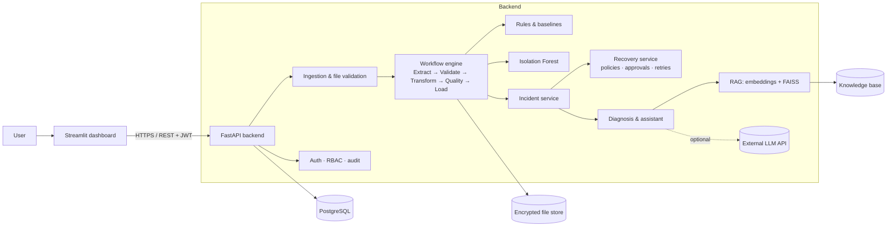

# DataPulse AI

**Intelligent data pipeline monitoring, root-cause analysis and controlled recovery.**

DataPulse AI processes CSV and JSON datasets through an ETL pipeline, detects data-quality problems with transparent rules and an Isolation Forest, explains incidents with an evidence-grounded assistant (LLM + RAG over FAISS), and recovers from eligible failures through predefined, audited actions. Everything is shown in a Streamlit dashboard backed by a FastAPI service and PostgreSQL.

It runs entirely on your machine. No AWS account, no cloud credentials and no LLM key are required; the LLM is optional and the system degrades to clearly labelled rule-based explanations without it.



## What it does

| Area | Implementation |
|---|---|
| Ingestion | CSV/JSON upload with extension, size, encoding, binary-content and structure checks; safe filenames; SHA-256; encryption at rest (Fernet). Uploaded files are parsed as data and never executed. |
| ETL | Five explicit stages with per-stage status and attempt logs. Header normalisation, schema comparison with rename suggestions, type coercion, constraint checks, de-duplication on the business key, derived columns. Rejected rows go to a quarantine file with reasons; nothing is silently deleted. |
| Data quality | Completeness, uniqueness, validity and schema conformance combined into a 0–100 score; configurable thresholds for duplicates, missing values, invalid values, volume drops/spikes, slow runs and repeated failures; truncated-file detection. |
| Machine learning | Per-pipeline Isolation Forest over six run-level features, trained on the pipeline's own history, persisted with joblib. With too little history it reports "insufficient history" instead of guessing. |
| Generative AI | Provider-agnostic client (OpenAI-compatible APIs or Anthropic), timeouts, 429/5xx retries with `Retry-After`, JSON-schema validation of responses, and a grounding check that flags any number the model states that is not in the evidence. |
| RAG | 11 troubleshooting guides → section chunking → Sentence Transformers embeddings (TF-IDF fallback) → FAISS inner-product index with a relevance threshold; persisted with a manifest and rebuilt automatically when the knowledge base changes or the index is missing. |
| Recovery | Automatic retries with exponential backoff for transient errors; automatic de-duplication; manual actions limited to `retry_run`, `rerun_with_dataset`, `apply_column_mapping` (admin approval) and `escalate`; retry limits, idempotency keys, suspension after repeated failures, and independent output validation before an incident is marked resolved. |
| Security | JWT sign-in, PBKDF2 password hashing, three roles (viewer, engineer, admin), sign-in throttling, audit log of every significant action, masking of sensitive columns, restricted record downloads, security headers, safe error messages, data-retention policy. |
| Dashboard | Nine pages: overview, data ingestion, pipeline runs, data quality, incidents, AI incident analyst, recovery, reports, administration. Every number comes from the API. Colour-coded visual system: each ETL stage owns a hue (Extract blue, Validate violet, Transform pink, Quality gold, Load green) reused across page banners, KPI tiles, stage tracks and charts (donuts, quality gauge, quality radar). |

## Quick start on Windows

Prerequisites: [Python 3.12](https://www.python.org/downloads/) (tick "Add to PATH"), [PostgreSQL 16](https://www.postgresql.org/download/windows/) and Git.

**1. Get the code and create a virtual environment** (PowerShell, in the project folder):

```powershell
python -m venv venv
venv\Scripts\activate
pip install --upgrade pip
pip install --extra-index-url https://download.pytorch.org/whl/cpu -r requirements.txt
```

The extra index installs the small CPU-only build of PyTorch used by Sentence Transformers. If you skip `sentence-transformers`, retrieval automatically uses TF-IDF.

**2. Create the database** (use the password you chose when installing PostgreSQL for the `postgres` user):

```powershell
psql -U postgres -c "CREATE USER datapulse WITH PASSWORD 'choose-a-password';"
psql -U postgres -c "CREATE DATABASE datapulse OWNER datapulse;"
```

If `psql` is not found, add `C:\Program Files\PostgreSQL\16\bin` to PATH, or use pgAdmin to run the same two statements.

**3. Configure the environment:**

```powershell
copy .env.example .env
python -c "import secrets; print(secrets.token_urlsafe(48))"
python -c "from cryptography.fernet import Fernet; print(Fernet.generate_key().decode())"
```

Open `.env` and set `DATABASE_URL` (with your password), paste the two generated values into `SECRET_KEY` and `DATA_ENCRYPTION_KEY`, and choose passwords for the three `BOOTSTRAP_*_PASSWORD` users (at least 10 characters, letters plus digits or symbols). Leave `LLM_API_KEY` empty to start; add it later to enable LLM explanations.

**4. Initialise and seed:**

```powershell
python scripts\init_db.py
python scripts\seed_database.py
python scripts\generate_sample_data.py
```

`seed_database.py` runs 14 synthetic daily batches through the real pipeline so that volume baselines and the Isolation Forest have history to learn from.

**5. Start the backend** (terminal 1):

```powershell
venv\Scripts\activate
cd backend
uvicorn app.main:app --reload --port 8000
```

API documentation: http://localhost:8000/docs

**6. Start the dashboard** (terminal 2):

```powershell
venv\Scripts\activate
cd frontend
streamlit run app.py
```

Open http://localhost:8501 and sign in with one of the bootstrap users.

### macOS / Linux

The same steps apply with `source venv/bin/activate`, `cp` instead of `copy`, forward slashes in paths, and `sudo -u postgres psql` for the database commands.

### Without PostgreSQL

Leave `DATABASE_URL` empty in `.env` and the application uses SQLite in `data/datapulse.db`. Everything works the same; PostgreSQL is recommended for the full setup.

### With Docker

```bash
cp .env.example .env        # fill POSTGRES_PASSWORD, SECRET_KEY, DATA_ENCRYPTION_KEY and the BOOTSTRAP passwords
docker compose up --build
docker compose exec backend python /app/scripts/seed_database.py
```

Dashboard on http://localhost:8501, API on http://localhost:8000. The database container is not exposed to the host.

## A five-minute demonstration

1. **Data ingestion → Synthetic samples → `synthetic_sales_clean.csv` → Use → Run pipeline.** All five stages pass; quality 100; no incidents.
2. **Use `synthetic_sales_missing_duplicates.csv`.** The run completes with warnings; duplicates are quarantined automatically under the keep_first policy (visible in Recovery) and a missing-values incident opens.
3. **Use `synthetic_sales_invalid_schema_change.csv`.** The run stops at Validate: `customer_id` is missing and the system suggests `cust_id → customer_id`.
4. **AI incident analyst → Analyse incident**, then ask "Which validation checks failed?" and "How can this issue be resolved?".
5. **Recovery → apply column mapping.** As an engineer it waits for approval; as an admin approve it. The pipeline re-runs, the output is validated, and the schema incident is resolved. The recovery run then reports the invalid values and the volume drop it found.
6. **Failure simulation**: run the clean sample with one or two simulated transient failures (recovered automatically) and with three (retry limit reached, escalated).
7. **Reports** for CSV/JSON exports; **Administration** for the audit trail.

## Tests and evaluation

```powershell
cd backend
python -m pytest -q
```

61 tests cover all 20 required scenarios plus security, LLM behaviour (mocked HTTP), RAG and the dashboard itself (every page is executed through Streamlit's `AppTest` against the real API). To run them against PostgreSQL, set `TEST_DATABASE_URL` to an empty test database.

```powershell
python scripts\evaluate.py
```

Generates 100 labeled synthetic datasets and measures detection rates, Isolation Forest precision/recall/F1/false-positive rate (with an ablation over its contamination parameter), RAG hit@k and MRR, throughput, recovery success and explanation grounding. Results are written to [`docs/evaluation_results.md`](docs/evaluation_results.md). The evaluation uses a temporary database and does not touch your data.

## Enabling the LLM

Set in `.env` and restart the backend:

```ini
# OpenAI or any OpenAI-compatible service (Groq, Together, Mistral, OpenRouter, Ollama, LM Studio ...)
LLM_PROVIDER=openai_compatible
LLM_BASE_URL=https://api.openai.com/v1
LLM_MODEL=<model name from your provider>
LLM_API_KEY=<your key>

# or Anthropic
LLM_PROVIDER=anthropic
LLM_MODEL=<model name>
LLM_API_KEY=<your key>
```

The key is read only by the backend; it is never sent to the dashboard or the browser. A local model through Ollama (`LLM_BASE_URL=http://localhost:11434/v1`, any non-empty key) works without cost.

## Project structure

```
datapulse-ai/
├── backend/
│   ├── app/
│   │   ├── main.py, config.py
│   │   ├── api/            REST routers (auth, uploads, pipelines, incidents, analytics, assistant, reports, admin)
│   │   ├── ingestion/      file validation, loaders, synthetic data generator
│   │   ├── processing/     validator, cleaner, transformer, error taxonomy
│   │   ├── monitoring/     metrics, baselines, rules, Isolation Forest
│   │   ├── ai/             LLM client, embeddings, RAG, diagnosis, assistant
│   │   ├── recovery/       workflow engine, recovery policies
│   │   ├── database/       models, connection, reference data
│   │   ├── security/       authentication, authorisation, audit, encryption
│   │   ├── services/       pipeline, incident, recovery, dataset, storage, retention
│   │   └── schemas/        Pydantic request/response models
│   ├── alembic/            database migrations
│   └── tests/              pytest suite (backend + dashboard)
├── frontend/               Streamlit dashboard (app.py, views/, components/, api_client.py)
├── knowledge_base/         troubleshooting guides used by RAG
├── scripts/                init, seed, samples, evaluation, index rebuild, retention, user creation
├── docs/                   report, deployment guide, CPPE mapping, API, security, evaluation results
├── data/                   runtime storage (git-ignored)
├── Dockerfile, docker-compose.yml, .github/workflows/ci.yml
└── .env.example
```

## Documentation

- [Project report](docs/PROJECT_REPORT.md) — the full final-year report with diagrams
- [Evaluation results](docs/evaluation_results.md) — measured, reproducible numbers
- [Wipro CPPE module mapping](docs/CPPE_MODULE_MAPPING.md)
- [Deployment guide](docs/DEPLOYMENT.md)
- [Security notes](docs/SECURITY.md) — what is implemented and what is not production-ready
- [API reference](docs/API.md)

## Honest limitations

- Processing uses Pandas on a single machine. It is not distributed big-data processing; PySpark is discussed in the report as an extension.
- All demonstration and evaluation data is synthetic.
- Pipeline runs execute synchronously within the request. This is adequate for files up to the 20 MB upload limit (100,000 rows complete in about 1–2 seconds); larger workloads would need a task queue.
- The access token is kept in Streamlit session memory; there is no refresh-token flow, password reset or single sign-on.
- LLM-generated explanations were exercised with mocked API responses in the tests; their quality depends on the model you configure.
